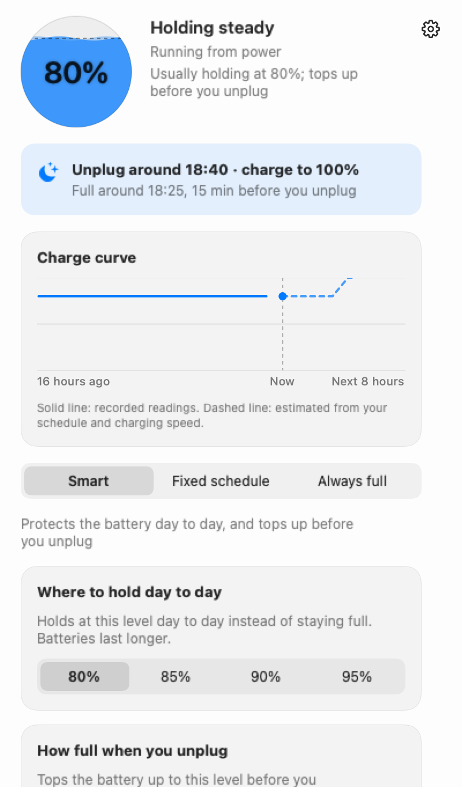
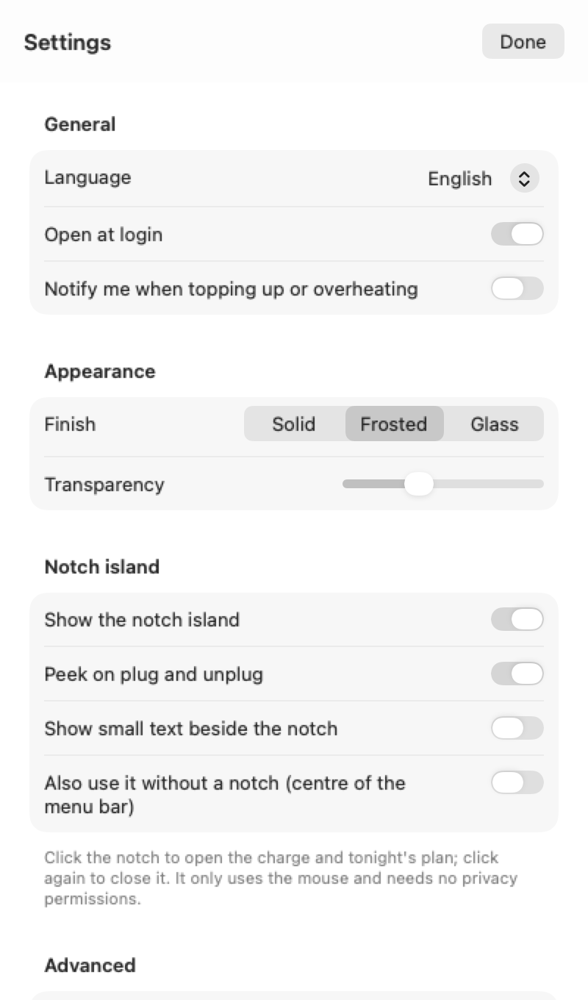
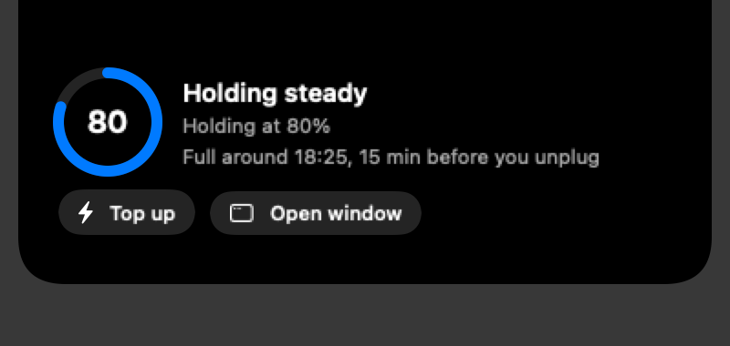

# Charge Limit

**Easier on your battery, and full enough when you unplug.**

Charge Limit is a macOS menu bar battery charge limit app for MacBook, on Apple silicon and Intel. Most of the time it holds the battery around 80%, so it doesn't sit full for hours, which helps protect battery health. It learns the time you usually unplug and fills the battery up before then. Free and open source.

English · [繁體中文](README.zh-Hant.md) · [简体中文](README.md)

<p align="center">
  
  
</p>

## Three modes

Pick one at the top of the window:

| Mode | Best for | What it does |
|---|---|---|
| **Smart** (default) | Most people | Holds your everyday limit (80%, or 85, 90, 95). It learns when you usually unplug, and before then charges to your target (100%, or 80, 90). |
| **Fixed schedule** | People who want to set the times | Splits the day into blocks, each holding the limit you choose (80, 85, 90, 95, 100). Time outside any block charges to 100%. Each block can turn on discharging, which needs the discharge helper. You can also choose "Full before unplugging". |
| **Always full** | Desktops, or machines that are always plugged in | Charges to 100% whenever it's on power. |

All three modes have heat protection: when the battery reaches 35°C the limit drops to 80%, and it resumes below 33°C.

## How it learns your habits

- The first time each day you stay on power for 30 minutes or more and then unplug counts as one "unplugged" event. Brief unplugs, like moving the laptop around, don't count.
- Once 3 of those land in the same half hour, it can say "you usually unplug around …", and fills the battery before that time.
- Records stay on this Mac and are never uploaded. To start over, tap "Learn again" in Smart mode. To stop learning, turn off "Remember my charging habits"; it then only uses the time you set yourself.

## Interface

- **Main window:** battery level, what it's doing now, tonight's plan, the charge curve (the last 16 hours as a solid line, and the next 8 hours as a dashed forecast), the three modes, and top-up.
- **Settings** (gear icon, top right): language (Simplified Chinese, Traditional Chinese, English, default follows the system), launch at login, notifications, appearance, Notch island, Advanced (discharge helper, no discharging today), and About.
- **Notch island** (Macs with a notch): click the notch to expand, click again to collapse. It pops up by itself when you plug or unplug power, and closes after a few seconds. On Macs without a notch, turn on "Also use it without a notch" in Settings to show it in the middle of the menu bar.

<p align="center">
  
</p>

## Install

Download the file for your chip from [Releases](https://github.com/1837620622/MacFullBar/releases):

- Apple silicon: `MacBatteryCharge-<version>-arm64.dmg` or `.pkg`
- Intel: `MacBatteryCharge-<version>-intel.dmg` or `.pkg`

Open the DMG and drag Charge Limit into Applications. The PKG walks you through installing it into Applications.

The app is not notarized by Apple. If macOS blocks it the first time, go to System Settings → Privacy & Security and click "Open Anyway".

## Updates

- While the app runs, it checks once after launch and then about every 6 hours. You can turn this off with "Check for new versions automatically" in Settings.
- When a new version is available, a notice appears at the top of the main window and in Settings. "Download New Version" opens the right installer for your chip in your browser, and you install it yourself. "Later" hides that version.
- The app never downloads or installs for you, and never asks for a password. After you install a new version, the old one still running reopens itself within a minute or two. Settings and data are kept.
- After installing a new version over the old one with the DMG, the discharge helper stays on the old version. Install it again in Settings → Advanced. The PKG replaces it automatically.

## Feedback

Settings → About → "Report an issue" opens a new GitHub issue in your browser, with the title and diagnostics filled in: app version, macOS version, mode, battery level, who is enforcing the limit, the state of the discharge helper and updates, and the last 120 log lines (your home folder is shown as `~`). The diagnostics don't include battery history or anything from the window. If they're too long for a URL, they're copied to the clipboard for you to paste into the issue.

## Permissions and privacy

- Reading the battery and temperature: no permission needed.
- Setting the charge limit: no password needed.
- No Full Disk Access, Accessibility, Screen Recording, or Input Monitoring. The Notch island only uses the mouse position and clicks.
- No account, no uploads of battery data, no usage tracking.
- The app makes one network request on its own: checking for new versions, which reads the version number and download link from GitHub. Everything else opens a GitHub page in your browser only when you click it (download, feedback, project homepage, sponsorship).

## Discharge helper (optional)

macOS's own charge limit only stops charging. It won't discharge while plugged in. To drop from 85% to 80%, the power adapter has to be disconnected briefly, which means writing to the SMC. That needs a small helper that runs as root.

- It is only used in blocks of a fixed schedule where you turned on "Discharging". Installing it asks for your administrator password once through macOS. The password never passes through this app.
- It does three things: disconnects and reconnects the power adapter; on Intel Macs without a system charge limit, stops charging through BCLM; and reports its status.
- Discharging needs all of these: the block has "Discharging" on, the battery temperature can be read, the charge is at least 3% above the limit and above 20%, and "No discharge today" is off. It reconnects power once the limit is reached.
- During sleep it doesn't discharge, and it reconnects power. If the app quits, or it hasn't heard from the app for two minutes, it reconnects power by itself.
- To remove it: Settings → Advanced → "Remove the discharge helper". It reconnects power before removing anything.

## Honest limits

- Keeping the battery ready before you unplug is not a guarantee. If you unplug earlier than usual, or charging is slower (a power bank, for example), you may not reach the target in time. When the Mac is too hot, the limit stays at 80%, so it may not fill up either.
- Apple's own limit isn't exact. It can be a few percentage points off and sometimes charges to 100%. The app can't change that.
- Temperature comes from the battery sensor the system reads, and may differ slightly from what other tools show. 35°C and 33°C are conservative values we chose; Apple's published range is an ambient 10–35°C.
- CI can build, test, package, and generate screenshots for this app, but it can't test on every real Mac. Try it on your own Mac, and report problems in [Issues](https://github.com/1837620622/MacFullBar/issues).

## Development

```bash
swift test                                              # Logic tests, no hardware involved
bash packaging/build.sh                                 # Build for both chips, make the PKG and DMG, check icons and languages
.build/release/MacBatteryCharge --snapshot snapshots    # Render UI screenshots from sample data
```

Design docs (in Chinese): [设计要求](docs/设计要求.md), [设计核对](docs/设计核对.md), [界面](docs/界面.md), [调研](docs/调研.md). Changes by version: [CHANGELOG](CHANGELOG.md).

## Sponsorship

Charge Limit is free and open source. Every feature is free, and it will stay free for individuals.

- **Individuals:** if it keeps you charged when you need it, you're welcome to sponsor it. Any amount is fine, and it unlocks nothing.
- **Companies:** sponsorship, custom work, and support can be arranged separately. See [enterprise cooperation](docs/企业合作.md) (in Chinese).

Payment options aren't set up yet. To sponsor or discuss a partnership, open an issue at [Issues](https://github.com/1837620622/MacFullBar/issues/new/choose) with the title "Sponsorship" or "Enterprise cooperation", and the author will reply.

## Acknowledgements

Thanks to [Calma](https://github.com/Milanpatel35/calma) and [batt](https://github.com/charlie0129/batt) for their public work and ideas.

## License

GNU GPL-3.0, see [LICENSE](LICENSE). © 2026 传康Kk.
