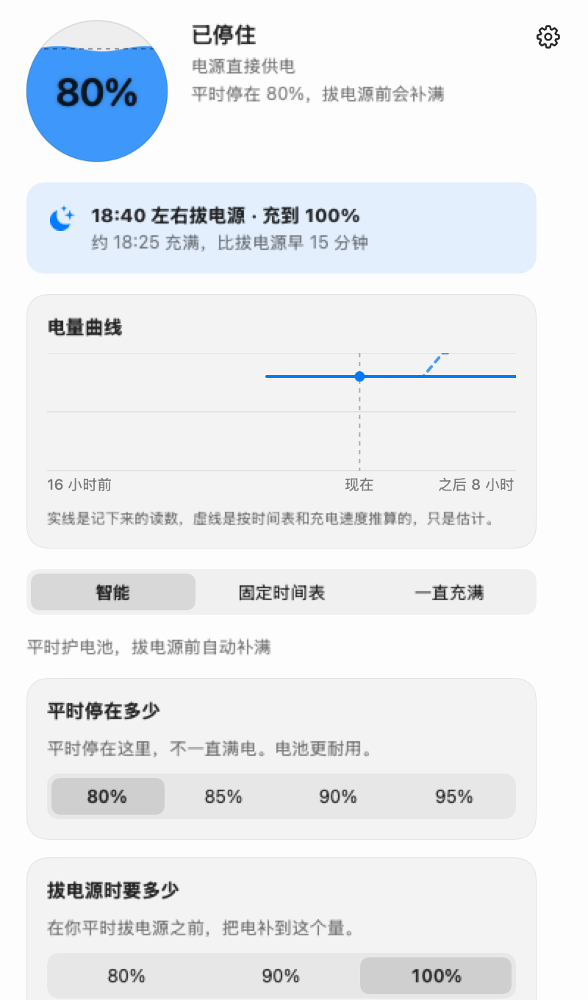
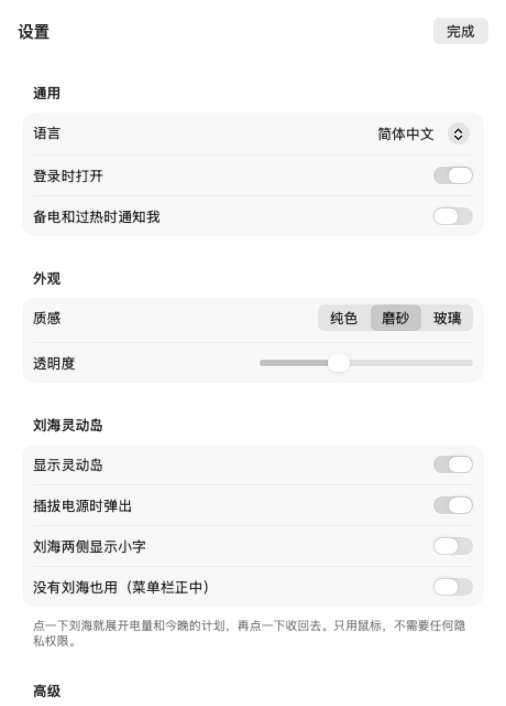
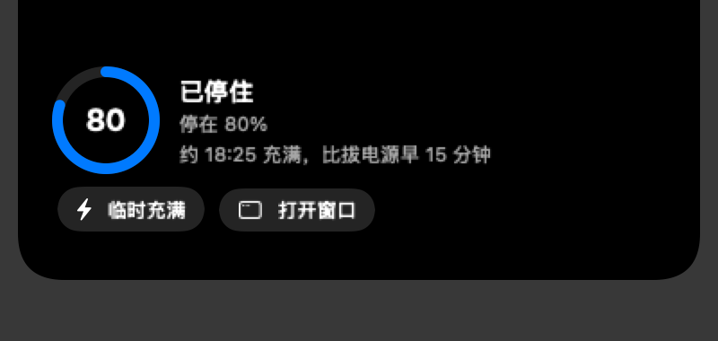

# 充電上限

**讓電池少受累，離開電源時電量剛剛好。**

充電上限是一個 macOS 選單列小工具。平時把電池停在 80% 左右，不讓它長時間滿電；你每天拔電源的時間，它會自己學會，在拔之前把電備足。免費，開源。

[English](README.en.md) · 繁體中文 · [简体中文](README.md)

<p align="center">
  
  
</p>

## 功能

### 保護電池健康

- **平時停在 80% 左右**：智慧模式的日常上限可選 80、85、90、95，也能自己填任意數字。電池不長時間滿電，老化會慢一些。
- **三種模式**：智慧、固定時間表、一直充滿，按你怎麼用這台 Mac 來選。
- **過熱保護**：三種模式都有。電池到 35°C 時最高停在 80%，降到 33°C 以下再恢復。
- **放電幫手（可選）**：電量高於上限時，可以放電降回上限，而不只是停止充電。
- **健康度和循環次數**：從系統讀取，在主視窗裡說明。健康低於 80% 時提醒可以考慮換電池；循環次數用掉八成以上時也會提醒。健康度是系統估算的。

### 需要用電的時候有電

- **學會你平時幾點拔電源**：一小時之內記滿 3 次，就在那個時間前把電充到你要的量（80、90、100，也能自己填）。
- **固定時間表裡的「拔電源前充滿」**：按這台 Mac 實際的充電速度算，時間夠的話提前放開上限，趕在拔電源前充滿。
- **臨時充滿**：馬上充到 100%，拔掉電源就結束。
- **工作日停電（宿舍）**：停電前充到你設的目標；停電時開低電量模式省電，來電就關。週末不管。

### 電量預警和提醒

- **主視窗的提示**：最多同時顯示三條，警告在前。包括：電池偏熱、充電器功率跟不上耗電（插著電卻還在掉電）、充得慢、健康偏低或循環用掉大半、放電時記憶體緊。
- **今晚的計畫**：算出預計充滿的時間。來不及充滿時直接說出來，並給一個「臨時充滿」按鈕。
- **系統通知**（預設關，在設定裡打開）：提前放開上限、因過熱先停在 80%、已經停在上限。

### 其他

- **電量曲線**：過去 16 小時的實線，和之後 8 小時的虛線預測。
- **習慣和細節**：看到學到了什麼、依據是什麼、最近幾次拔電源的時間、還差幾次，以及溫馨提醒。
- **劉海靈動島**：插拔電源時自動彈出，可以直接點「臨時充滿」。
- **三種語言**：簡體中文、繁體中文、English，預設跟隨系統。
- **登入時開啟、自動檢查新版本、回報問題**：回報時診斷資訊已經填好，直接在 GitHub 開 issue。

## 三種模式

視窗頂上選一個：

| 模式 | 適合誰 | 它做什麼 |
|---|---|---|
| **智慧**（預設） | 大多數人 | 平時停在你選的上限（80%，可選 85、90、95）。記住你平時幾點拔電源，離電前充到你要的量（100%，可選 80、90）。兩個數都能點「自訂」，填任意數字。 |
| **固定時間表** | 想自己排時間的人 | 一天分幾段，每段停在你選的上限（80、85、90、95、100）。沒排到的時間按 100% 充。每段還能打開「放電」（要裝放電幫手）。可以選「拔電源前充滿」。 |
| **一直充滿** | 桌上型電腦，或一直插著用的機器 | 接上電源就充到 100%。 |

三種模式都有過熱保護：電池溫度到 35°C 時最高停在 80%，降到 33°C 以下再恢復。

## 它怎麼記住你的習慣

- 每天第一次接著電源滿 30 分鐘以上、然後拔掉，就記作一次「離開電源」。白天挪個地方、短暫插拔，不算。
- 一小時之內記滿 3 次，就能說出「你平時大約幾點拔電源」，之後在那個時間前把電備好。設定裡的「習慣和細節」能看到記了哪幾次、還差幾次，以及溫馨提醒。
- 紀錄只存在這台 Mac 上，不上傳。想重新學，在智慧模式裡點「重新學習」。不想讓它學，關掉「記住我的充電習慣」，就只按你自己設的時間備電。

## 介面

- **主視窗**：電量、現在在做什麼、今晚的計畫、電量曲線（過去 16 小時的實線，和之後 8 小時的虛線預測）、三種模式、臨時充滿。
- **設定**（右上角齒輪）：語言（簡體中文、繁體中文、English，預設跟隨系統）、登入時開啟、通知、工作日停電（宿舍）、外觀、劉海靈動島、進階（放電幫手、今天不放電）、關於。
- **劉海靈動島**（有劉海的 Mac）：點一下劉海展開，再點一下收回去；插拔電源時會自己彈出來，幾秒後收起。沒有劉海的 Mac，可以在設定裡打開「沒有劉海也用」，它會掛在選單列正中。

<p align="center">
  
</p>

## 安裝

到 [Releases](https://github.com/1837620622/MacFullBar/releases) 下載對應晶片的檔案：

- Apple 晶片：`MacBatteryCharge-<版本>-arm64.dmg` 或 `.pkg`
- Intel：`MacBatteryCharge-<版本>-intel.dmg` 或 `.pkg`

DMG 打開後，把「充電上限」拖進「應用程式」。PKG 會帶你走一遍安裝，裝進「應用程式」。

軟體沒有經過 Apple 公證。第一次打開被系統攔下時，到「系統設定 → 隱私權與安全性」，點「仍要打開」。

## 更新

- 開著的時候，啟動後查一次，之後大約每 6 小時查一次。設定裡的「自動檢查新版本」可以關掉。
- 查到新版本，視窗最上面和設定裡都會提示。點「下載新版本」，在瀏覽器裡下載對應晶片的安裝包，自己打開安裝。點「以後再說」，這一版就不再提示。
- 軟體不替你下載，也不替你安裝，不要密碼。裝好以後，正在執行的舊版本會在十幾秒內自己重新打開，設定和資料都保留。
- 用 DMG 覆蓋安裝後，放電幫手還是舊版本，要在「設定 → 進階」裡重新裝一次。用 PKG 安裝會自己換掉它。

## 回報問題

「設定 → 關於 → 反饋問題」會在瀏覽器裡打開 GitHub 的新建 issue，標題和診斷資訊已經填好：軟體版本、系統版本、模式、電量、上限是誰在管、放電幫手和更新的狀態，以及最近 120 行日誌（使用者目錄已經換成 `~`）。診斷裡沒有電池的歷史紀錄，也沒有視窗裡的內容。內容太長放不進網址時，會複製到剪貼簿，你在頁面裡貼上就行。

## 權限和隱私

- 讀電池和溫度：不需要任何授權。
- 設定充電上限：不需要密碼。
- 不需要完全磁碟取用權限、輔助使用、螢幕錄製或輸入監控。劉海靈動島只用滑鼠位置和點擊。
- 不需要帳號，不上傳電池資料，不收集使用習慣。
- 軟體自己的連網只有一件事：查新版本，讀 GitHub 上的版本號和下載連結。其餘都是你點了，才在瀏覽器裡打開 GitHub 的頁面（下載、反饋、專案主頁、贊助）。

## 放電幫手（可選）

macOS 自己的充電上限只會停止充電，不會在接著電源時放電。要把電池從 85% 降到 80%，需要暫時斷開電源轉接器，這要寫系統的 SMC，所以要一個 root 權限的小程式。

- 只有固定時間表裡你打開「放電」的時間段才會用到它。安裝時系統會問一次管理員密碼，密碼不經過本軟體。
- 它只做三件事：斷開或接回電源轉接器；在沒有系統充電上限的 Intel 機器上，用 BCLM 停止充電；回報自己的狀態。
- 放電要同時滿足：這一段開著「放電」，電池溫度讀得到，電量高於上限 3% 以上，並且不低於 20%，今天沒有點「今天不放電」。放到上限就接回電源。
- 睡眠時不放電，會接回電源。軟體退出，或者兩分鐘沒收到軟體的指令，它也會自己接回電源。
- 解除安裝：「設定 → 進階 → 解除安裝放電幫手」。解除安裝前會先把電源接回來。

## 工作日停電和低電量模式（需要放電幫手）

住宿舍、工作日晚上會停電的人，可以在「設定 → 工作日停電」裡打開它，設好停電和來電的時間，預設 23:30 到次日 06:00。

- 只在週一到週五生效。週末在家，全天有電，照常用上面的設定。
- 停電前，軟體會把電充到你設的目標（預設 100%），停電時電池是滿的。
- 停電時沒有電源，軟體打開 macOS 的低電量模式，省電。來電就馬上關掉，白天充電不開，免得卡影響辦公。
- 只關掉它自己開過的那次，你手動設的不動。
- 低電量模式用的是放電幫手，裝一次就夠。

## 說實話的限制

- 離電前備電不是保證。離電時間提前，或者充電變慢（比如換了行動電源），都可能到點還沒充滿。過熱時最高停在 80%，也會充不滿。
- 蘋果自己的上限不是精確的，會有幾個百分點的誤差，偶爾也會充到 100%。軟體阻止不了這一點。
- 溫度來自系統的電池感測器，和系統裡顯示的可能略有出入。35°C 和 33°C 是我們選的保守值，蘋果公布的是環境溫度 10–35°C。
- 我們在 CI 裡能編譯、跑測試、打包、產生截圖，但不能替你在每一台真機上測。請在自己的 Mac 上試一下，遇到問題到 [Issues](https://github.com/1837620622/MacFullBar/issues) 回報。

## 開發

```bash
swift test                                              # 邏輯測試，不碰硬體
bash packaging/build.sh                                 # 編譯兩種晶片，打 PKG 和 DMG，並檢查圖示和語言都在
.build/release/MacBatteryCharge --snapshot snapshots    # 用假資料輸出介面截圖
```

設計文件：[設計要求](docs/設計要求.md)、[設計核對](docs/設計核對.md)、[介面](docs/界面.md)、[調研](docs/调研.md)。版本變化見 [CHANGELOG](CHANGELOG.md)。

## 贊助

充電上限免費、開源，所有功能都不收費，以後也不會對個人收費。

- **個人**：如果它幫你在需要的時候有足夠的電量，歡迎自願贊助，金額隨意，不影響任何功能。
- **企業**：贊助、客製開發和技術支援可以另外談，見 [企業合作](docs/企業合作.zh-Hant.md)。

目前還沒有開通收款方式。想贊助或者談合作，就在 [Issues](https://github.com/1837620622/MacFullBar/issues/new/choose) 裡開一條，標題寫「贊助」或「企業合作」，作者看到後會回覆。

## 致謝

感謝 [Calma](https://github.com/Milanpatel35/calma) 和 [batt](https://github.com/charlie0129/batt) 公開的資料和思路。

## 授權

GNU GPL-3.0，見 [LICENSE](LICENSE)。© 2026 傳康Kk。
